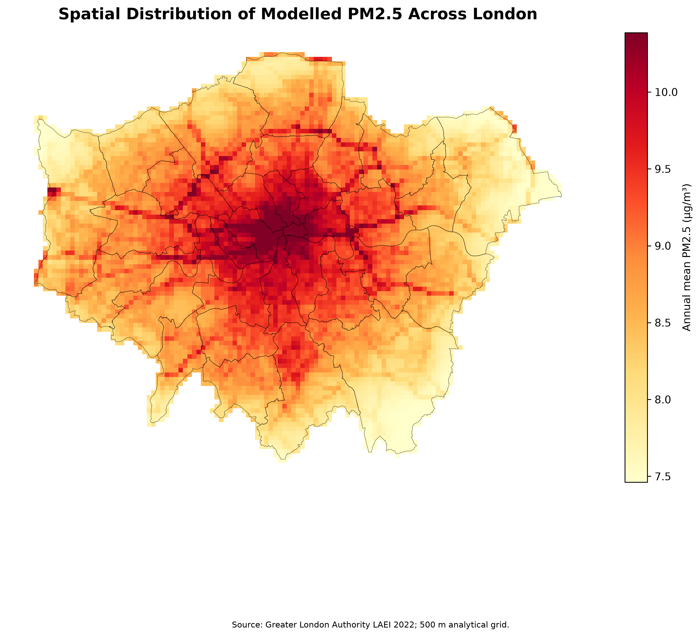
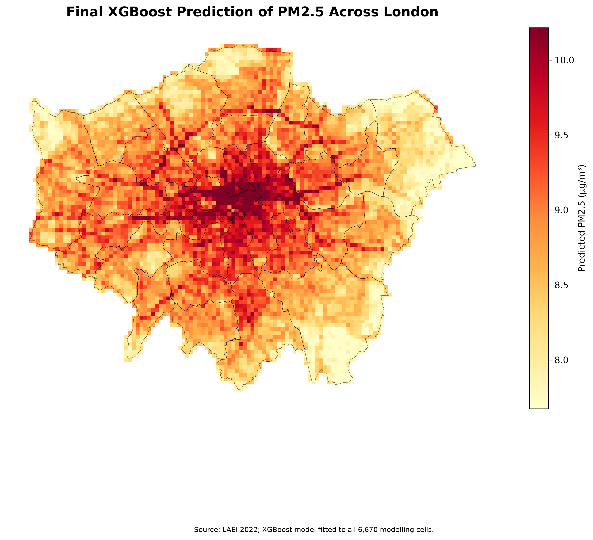
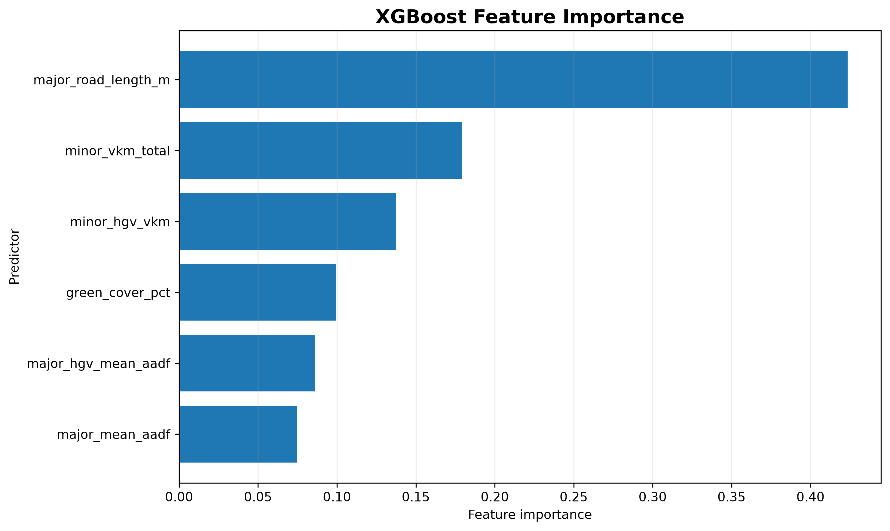
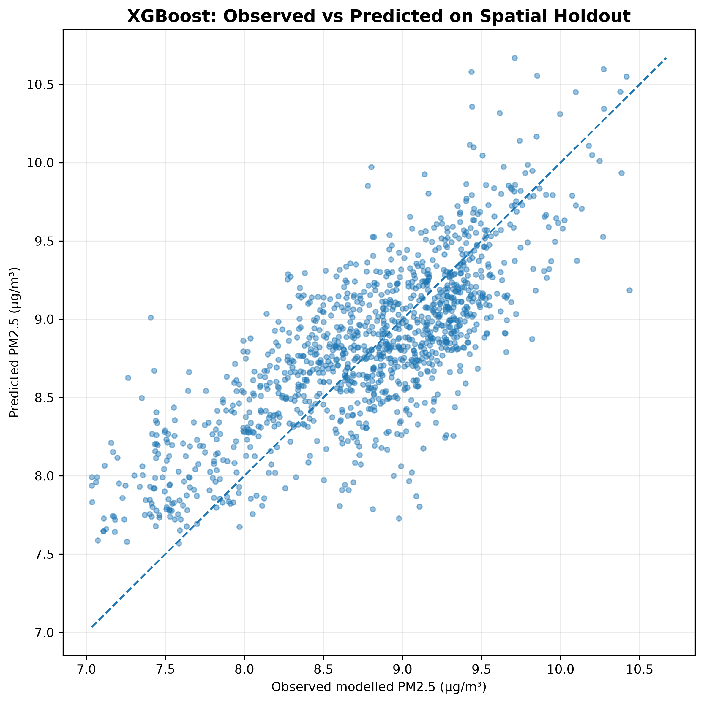

# Spatial Patterns and Machine Learning Prediction of PM₂.₅ in London

How do traffic exposure and green cover relate to spatial variation in PM₂.₅ across Greater London, and how accurately can machine-learning models predict it in areas they have not seen? This project combines three official Greater London Authority (GLA) datasets on a common 500 m grid and compares Linear Regression, Random Forest and XGBoost using a **spatial block holdout**.

<p align="center">
  
  
</p>

## Key results

The test set holds out **19 of 91 spatial blocks (5 km × 5 km), or 1,206 of 6,670 grid cells**:

| Model | R² | RMSE (µg/m³) | MAE (µg/m³) |
|---|---:|---:|---:|
| **XGBoost** | **0.598** | **0.413** | **0.334** |
| Random Forest | 0.586 | 0.419 | 0.339 |
| Linear Regression | 0.431 | 0.492 | 0.386 |

- Tree-based models clearly beat the linear baseline (R² 0.43 → 0.59–0.60), which suggests non-linear relationships between traffic, green cover and PM₂.₅.
- XGBoost is only slightly better than Random Forest, so the gain is incremental.
- **Road exposure dominates** XGBoost feature importance: major-road length 0.42, minor-road VKT 0.18, minor-road HGV VKT 0.14. Green cover follows at 0.10.
- Correlations with PM₂.₅: major-road length r = +0.62, green cover r = −0.49.
- Hotspots (top 10% of cells, > 9.74 µg/m³) cluster in inner and central London.

<p align="center">
  
  
</p>

## Data

All data come from the [London Datastore](https://data.london.gov.uk/) and are in British National Grid (EPSG:27700).

| Dataset | Use |
|---|---|
| [LAEI 2022 concentrations](https://data.london.gov.uk/dataset/london-atmospheric-emissions-inventory-laei-2022-2lg5g): annual-mean PM₂.₅ at 20 m resolution (5.85 M cells) | Target, averaged to 500 m |
| LAEI 2022 traffic flows: major-road AADF and minor-road VKT | Traffic predictors |
| [Green Cover 2024](https://data.london.gov.uk/dataset/green-cover-2024-e56n0) (GLA, ML-classified aerial imagery) | Green-cover % per cell |
| [London Boroughs](https://data.london.gov.uk/dataset/london-boroughs-e55pw) | Study-area boundary |

**Predictors:** major-road mean AADF, major-road HGV mean AADF, major-road length, minor-road VKT, minor-road HGV VKT, and green-cover %.

## Method

1. **Grid.** Build a 500 m grid over Greater London's borough boundaries.
2. **Spatial aggregation.**
   - PM₂.₅: mean of the 20 m cells in each grid cell.
   - Major roads: road length and length-weighted flows.
   - Minor-road VKT: allocated by area overlap.
   - Green cover: polygon area as a % of each cell.
3. **Dataset.** Merge, clean and keep the **6,670 complete cells**.
4. **Validation.** Group cells into 5 km blocks and hold out 20% of the blocks (random seed 42). This reduces spatial leakage between neighbouring cells.
5. **Models.** Compare Linear Regression, Random Forest and XGBoost on R², RMSE and MAE. The best model (XGBoost, chosen by RMSE) is refitted on all cells to produce a city-wide prediction surface.

## Limitations

- The target is the **modelled** LAEI surface, not direct monitoring observations. The models therefore learn the spatial structure of an emissions/dispersion model.
- Green cover is itself a machine-learning classification. Traffic variables are spatially allocated from road-level and 1 km source data.
- Feature importance shows **predictive association, not causal effect**.
- Future work: validate against independent monitoring data (e.g. LAQN sites) and add meteorological and land-use predictors.

## Repository structure

```
├── src/config.py                 # paths and project settings
├── scripts/                      # pipeline steps (run in order below)
├── notebooks/                    # 01 inspection → 02 spatial prep → 03 EDA → 04 ML
├── figures/                      # all generated figures
├── outputs/                      # metrics, predictions, feature importances
└── data/
    ├── README.md                 # how to download the raw GLA data
    ├── raw/                      # (not tracked) raw downloads
    └── processed/                # final 500 m modelling dataset + grid
```

**Pipeline order** (from the repository root):

| Step | Scripts |
|---|---|
| Inspect sources | `inspect_sources.py`, `inspect_pm25.py`, `profile_pm25.py`, `inspect_traffic.py`, `check_traffic_crs.py`, `inspect_green_cover.py` |
| Build grid and aggregate | `extract_traffic.py` → `build_grid.py` → `aggregate_pm25.py` → `aggregate_traffic.py` → `aggregate_green_cover.py` → `validate_green_cover.py` |
| Build dataset | `build_dataset.py` → `clean_dataset.py` |
| Explore | `eda.py`, `create_spatial_maps.py` |
| Model | `compare_models.py` → `create_final_model_outputs.py` |
| Earlier two-model run (LR vs RF) | `train_models.py` → `model_diagnostics.py` |

## Reproduce

The final modelling dataset (`data/processed/london_pm25_final.parquet`) is included, so the modelling step runs without the raw downloads:

```bash
git clone https://github.com/JiaxiMao/london-pm25-ml.git
cd london-pm25-ml
pip install -r requirements.txt
python scripts/compare_models.py
```

To rebuild everything from scratch, download the raw data into `data/raw/` (see `data/README.md`) and run the pipeline in the order above.

## Tools

Python · GeoPandas · Shapely · pandas · scikit-learn · XGBoost · matplotlib

## References

- Breiman, L. (2001). Random forests. *Machine Learning*, 45, 5–32.
- Chen, T., & Guestrin, C. (2016). XGBoost: A scalable tree boosting system. *Proc. 22nd ACM SIGKDD*, 785–794.
- Greater London Authority. *London Atmospheric Emissions Inventory (LAEI) 2022*; *Green Cover 2024*; *London Boroughs*. London Datastore. Contains public sector information licensed under the Open Government Licence v3.0 (check each dataset page for its licence).
